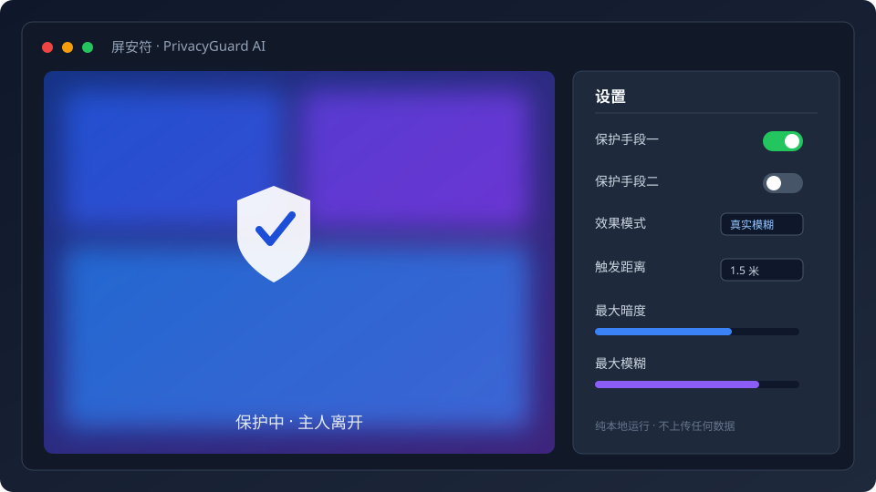

# 屏安符（ScreenPrivacyGuard）

> 一个纯本地运行的 AI 隐私屏保：用摄像头识别陌生人或机主离开，自动模糊 / 遮挡屏幕，让旁人看不到你在看什么。

**屏安符**是一款跨平台的桌面隐私防护原型（Windows 10/11 + macOS）。它完全在本机运行——人脸检测、机主识别、屏幕模糊全部离线完成，**不上传任何画面或人脸数据**。当你离开座位、或有陌生人靠近时，屏幕会自动进入保护状态。



## 核心特性

- **本地人脸识别**：使用 OpenCV YuNet 做人脸检测、SFace 做机主识别，20 张样本完成机主录入。
- **机主缺席即保护（fail-closed）**：录入机主后，只要镜头里看不到机主（比如你起身离开），即使没有陌生人，屏幕也会保持保护；短暂低头 / 侧身有宽限时间，避免误触发。
- **基于距离的强度调节**：根据人脸在画面中的大小估算距离（结合设定的摄像头视角），越近保护越强，暗度与模糊度平滑渐变。
- **两种独立保护手段**：① 全屏模糊 / 遮挡覆盖层；② 自动把指定程序窗口置顶（仅 Windows）。各自可独立开关、独立配置触发规则。
- **防闪烁**：非对称平滑（保护快、解除慢）+ 显示迟滞 + 漏检宽限 + 渐进淡入淡出，避免覆盖层反复闪现；Windows 上真实模糊用 `WDA_EXCLUDEFROMCAPTURE` 让覆盖层不进入截屏，抓屏时无需隐藏窗口，从根本上消除周期闪烁。
- **隐私优先**：所有处理均在本机完成，机主特征向量保存在本地配置，不联网、不上传。

## 环境要求

- Python 3.11（推荐，3.10+ 可能可用）
- 摄像头
- Windows 10/11，或较新版本的 macOS
- macOS 上若使用"真实模糊"，需给终端或打包后的 App 授予「屏幕录制 / 屏幕与系统音频录制」权限，以及摄像头权限

## 安装

### Windows（PowerShell）
```powershell
py -3.11 -m venv .venv
.venv\Scripts\Activate.ps1
python -m pip install --upgrade pip
pip install -r requirements.txt
python main.py
```

### macOS
```bash
python3.11 -m venv .venv
source .venv/bin/activate
python -m pip install --upgrade pip
pip install -r requirements.txt
python main.py
```

首次启动会把两个 OpenCV Zoo 的 ONNX 模型下载到 `~/.privacyguard-ai/models/`，**只有这一次需要联网**，之后完全离线。

## 首次使用

1. 点「注册 / 更新机主人脸」。
2. 正对摄像头、保持面部无遮挡几秒。
3. 等待采集满 20 张样本。
4. 先选「简易模式」，让另一个人走近测试效果。
5. 再切到「真实模糊」测试屏幕捕获（系统如弹出权限提示请允许）。

## 两种保护手段

设置界面里两种手段并列展示，各有自己的**启用开关**和**触发规则**（可多选「有陌生人」「主人离开」）：

- **保护手段一 · 窗口模糊 / 遮挡覆盖**：全屏模糊 / 暗色遮罩。可开关、选触发原因，并调节效果模式、触发距离、暗度与模糊强度。
- **保护手段二 · 自动置顶指定程序**（仅 Windows）：把指定窗口切到最前。可开关、选触发原因，并添加程序规则：
  - **点选当前窗口…**：从当前打开的窗口列表中点选，自动记录进程名。
  - **手动添加…**：输入进程名（如 `chrome.exe`）和 / 或窗口标题关键字。

程序规则按「进程名 + 标题关键字」匹配（可只填其一），两者都不区分大小写，且至少填一项。当某手段处于启用状态、且触发原因与当前情况匹配时，它就会启动；情况解除或程序退出后，窗口会还原到原来的置顶状态。两种手段完全独立——关掉模糊覆盖不会影响自动置顶。自动置顶由实时识别原因直接驱动，即使覆盖层关闭也能工作。非 Windows 平台会显示提示并禁用该区域。

## 操作说明

- **暂停保护**：临时关闭隐私保护覆盖层。
- **退出**：关闭程序。
- 主窗口始终可用于设置，覆盖层仅在触发保护时出现。
- 设置窗口可自由缩放（最小 620×420）；内容超过窗口高度时会出现垂直滚动条；摄像头画面可用「▾ 收起摄像头画面」折叠（后台识别照常运行）。相关表单项已合并到同一行，布局更紧凑。
- 快捷键：`Ctrl+Shift+P` 暂停 / 恢复保护，`Esc` 暂停。

## 防闪烁与流畅度调优

检测到的距离和人脸命中天然会逐帧抖动。屏安符通过非对称缓动（保护快、解除慢）+ 显示迟滞 + 漏检宽限吸收抖动；覆盖层只在保护时显示（从全透明淡入、淡出后才隐藏），空闲时根本不在屏幕上，不会拦截鼠标点击；Windows 上还通过扩展样式实现鼠标穿透。以下参数可在 `~/.privacyguard-ai/config.json` 中调整：

- `risk_rise_alpha` / `risk_fall_alpha`（0~1）：缓动速度。越小越平滑，但反应越慢。
- `show_threshold` / `hide_threshold`：进入 / 离开保护的迟滞区间（hide 应小于 show）。
- `stranger_miss_grace`（秒）：陌生人短暂漏检后，保护维持的时间。
- `capture_interval_ms`（真实模糊）：抓屏间隔，越小越跟手但越耗 CPU。
- `blur_kernel_size`（真实模糊）：高斯核尺寸，强度由连续 sigma 控制，不会出现明显跳档。
- `exclude_from_capture`（Windows，真实模糊）：让覆盖层不进入屏幕捕获，从而无需隐藏。仅当你的截图工具出现残留自捕获时才关闭。
- `protect_when_owner_absent`：启用后（且已录入机主），机主离开画面即保护；关闭则回到"只防陌生人"。
- `owner_absent_risk`：机主离开且无陌生人时使用的保护强度（0~1）。
- `owner_absent_grace`（秒）：机主离开视野多久后才触发保护（避免低头误判）。
- `overlay_enabled` / `auto_raise_enabled`：两种手段的独立开关。关掉模糊覆盖**不会**影响自动置顶（反之亦然）。
- `overlay_triggers` / `auto_raise_triggers`：各手段的触发原因列表，可选值 `"stranger"`（检测到陌生人）和 `"owner_absent"`（机主不在画面）。可多选；留空则回退为两种都触发。

## 重要限制

- 普通 RGB 摄像头无法测量深度。距离是根据人脸视觉大小、假定平均脸宽（14.5 cm）和摄像头水平视角估算的。请把视角设为与你摄像头相符的值，最好用已知距离标定一次。
- SFace 匹配不是安全级生物认证。光照、姿态、摄像头质量和外貌变化都会影响识别。请保留手动暂停 / 关闭快捷键。
- 真实模糊覆盖层在屏幕上持续存在且不闪烁：Windows 上用 `WDA_EXCLUDEFROMCAPTURE` 让覆盖层不进入屏幕捕获（无需自我隐藏），抓到的画面经模糊后持续替换；其他平台回退到极短隐藏。首帧平滑淡入而非突然出现，模糊强度连续变化（固定核 + 连续 sigma）。若你的捕获工具不支持该机制，可在配置里把 `exclude_from_capture` 设为 `false` 走回退路径。原型仅捕获主显示器。
- 受保护内容、DRM 视频、安全桌面、部分全屏游戏以及某些 macOS 捕获场景可能无法截获。
- 本原型不上传画面或人脸特征，机主特征保存在本地配置中。请保护好你的系统账户。
- 在高风险环境中，请勿把它当作物理隐私措施的替代品。

## 打包为独立程序

### Windows / macOS
```powershell
pip install pyinstaller
pyinstaller --noconfirm --windowed --name ScreenPrivacyGuard main.py
```
正式分发时，请从签名后的 `.app` / `.exe` 测试摄像头与截屏权限；macOS 分发通常需要签名与公证。

## 项目结构

```text
PrivacyGuardAI/
├── main.py                 # 程序入口
├── requirements.txt
├── README.md
├── docs/                   # GitHub Pages 项目主页
│   └── index.html
└── privacyguard/
    ├── __init__.py
    ├── app.py              # 主界面与两种手段的联动逻辑
    ├── config.py           # 配置定义、加载与兼容处理
    ├── overlay.py          # 全屏模糊 / 遮挡覆盖层
    ├── vision.py           # 摄像头采集、人脸检测与风险决策
    └── windowctl.py        # Windows 窗口枚举 / 置顶 / 还原
```

## 许可证

见 [LICENSE](LICENSE)。
